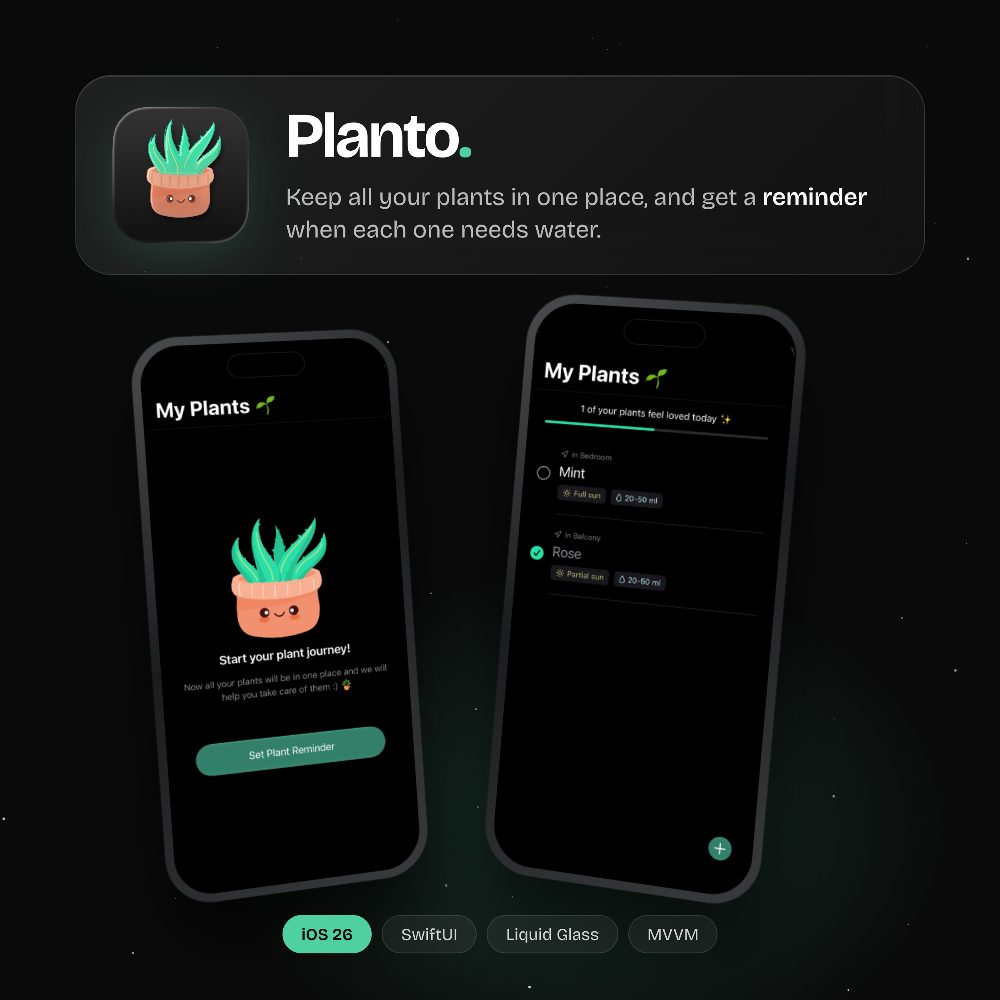
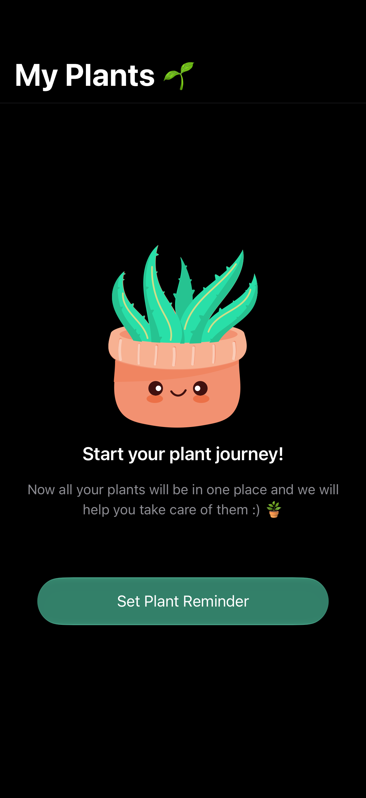
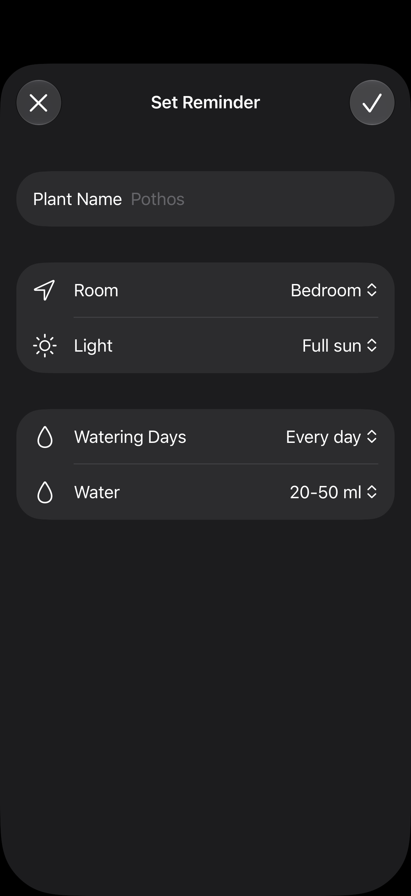
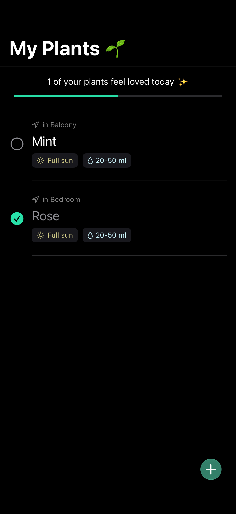
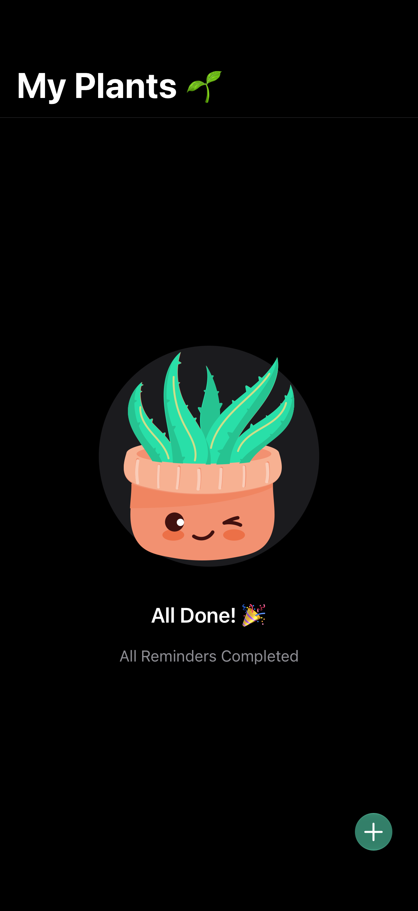

# 🌱 Planto
**A plant watering reminder that keeps all your plants in one place and reminds you when each one needs**

---

## Features

- **Add** a plant with its room, light, watering days, and water amount
- **Check off** plants when you water them, and track your progress
- **All Done** screen when every plant is watered
- **Edit** a plant by tapping it, **delete** it by swiping
- **Reminders** at 9 AM on each plant's next watering day

---

## Screenshots
| Welcome | Set Reminder | My Plants | All Done |
|:---:|:---:|:---:|:---:|
|  |  |  |  |

## Built With

- **SwiftUI** and **Liquid Glass** (iOS 26)
- **MVVM**: Models (data), Views (UI), ViewModel (logic), and a Manager for notifications
- **Observation** (`@Observable`) so views update automatically
- **UserNotifications** for local reminders

---

## Run the App

1. Clone the repo and open `PlantoApp.xcodeproj` in **Xcode 26**
2. Choose an iPhone simulator and press **Cmd + R**

---

**Razan Abdulrahman Alsulami** · Apple Developer Academy
